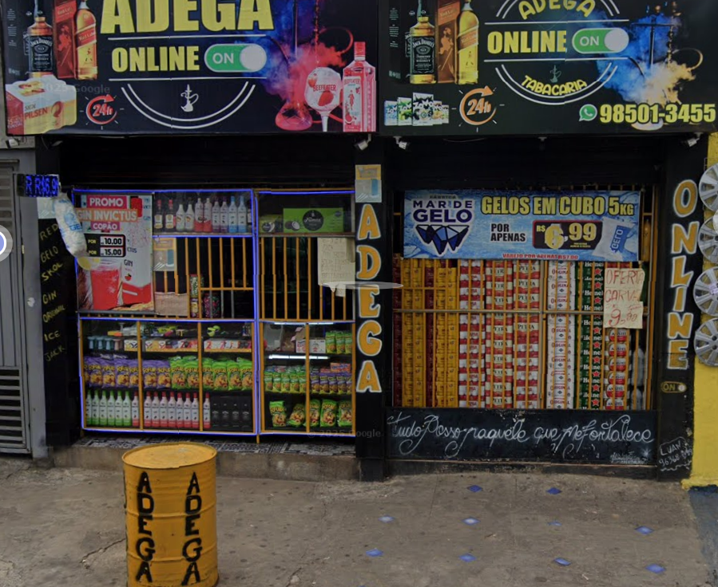
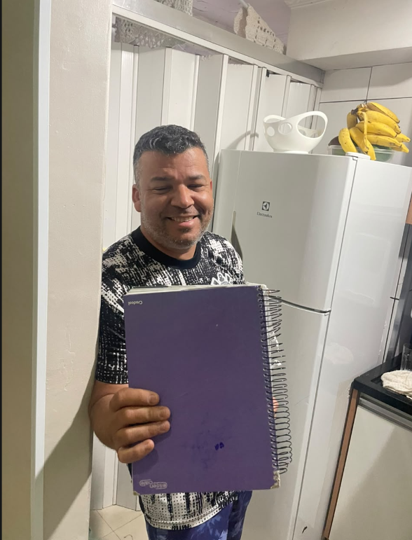
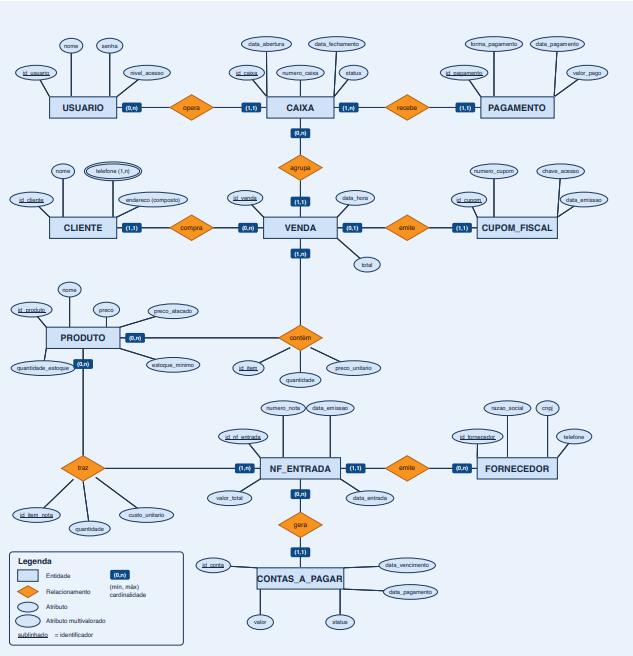

# Adega Online — Gestão de Vendas e Estoque
  
Sistema de automação comercial e gestão de dados desenvolvido para apoiar as operações de uma organização real que atua nos segmentos de adega e tabacaria.   

O projeto tem como foco centralizar o cadastro de produtos, o controle de estoque, o registro de vendas, o gerenciamento de clientes que realizam compras a prazo ("fiado") e o acompanhamento das operações realizadas pelos usuários do sistema.

---
 
## Metadados 

### Integrantes

| Nome | RGM |
|---|---:|
| Denner | 4733816 |
| Guilherme Schiavinato | 47769068 |
| Igor Hideki | 47658673 |
| Juan Craveiro | 45005273 |
| Victor Silva | 47787945 |

---

# 1. Caracterização da Organização

## Nome e natureza da organização

A organização escolhida para o desenvolvimento do projeto é a **Adega Online**, um estabelecimento comercial privado e com fins lucrativos que atua conjuntamente nos segmentos de **adega e tabacaria**.

O grupo possui acesso direto à organização para realização da pesquisa de campo, pois um dos integrantes da equipe é colaborador do local. Essa condição possibilitou observar a operação e levantar informações relacionadas aos processos reais do estabelecimento.

## Contexto e porte

A operação possui uma equipe enxuta de aproximadamente **4 colaboradores**. Apesar do número reduzido de funcionários, o estabelecimento apresenta alta rotatividade operacional, com volume de vendas e movimentação contínua de mercadorias.

Também existe a gestão de contas de crédito interno, popularmente chamadas de **"fiado"**, utilizadas por clientes recorrentes.

## Problemas e necessidades identificados

Durante o levantamento foram identificados problemas relacionados principalmente à falta de centralização e automatização dos processos:

- **Desorganização do estoque:** dificuldade de manter um controle rigoroso sobre entradas e saídas de mercadorias.
- **Vendas fragmentadas:** ausência de integração adequada entre vendas e controle financeiro.
- **Gestão de fiados:** controle descentralizado de clientes devedores e valores em aberto.
- **Desalinhamento operacional:** dificuldade de acompanhar se os procedimentos de registro e controle estão sendo seguidos corretamente.
- **Risco de perdas e divergências:** maior possibilidade de erros humanos, esquecimentos e divergências no controle financeiro e de mercadorias.

## Justificativa da escolha

A Adega Online foi escolhida por dois motivos principais.

Primeiramente, existe acesso direto à organização por meio de um integrante do grupo que trabalha no local, facilitando a pesquisa de campo e o levantamento dos requisitos.

Além disso, a organização apresenta processos suficientemente diversificados para a aplicação dos conceitos de modelagem de dados, envolvendo produtos, estoque, vendas, clientes, crédito interno e usuários.

## Evidências da organização

**Nome fantasia:** Adega Online  
**Endereço:** Rua Dona Eloá do Vale Quadros, nº 17  
**Telefone:** (11) 98501-3455

O grupo realizou levantamento de campo e possui registros fotográficos da organização.

### Registro da organização



### Registro relacionado à pesquisa de campo



> **Observação:** as imagens acima devem ser colocadas no repositório nas pastas indicadas, utilizando os nomes de arquivo correspondentes.

---

# 2. Processos de Negócio

A operação da Adega Online está estruturada em torno de rotinas comerciais essenciais para o atendimento, controle financeiro e gerenciamento das mercadorias.

## Principais processos mapeados

### Cadastro de Produtos

Registro dos itens comercializados, incluindo informações como descrição, preço e dados necessários para o controle dos produtos.

### Controle de Estoque

Monitoramento da quantidade de produtos disponíveis nas prateleiras e no depósito, permitindo acompanhar as saídas e auxiliar na reposição.

### Cadastro de Clientes — Fiado

Gerenciamento dos clientes autorizados a realizar compras a prazo, mantendo informações relacionadas aos débitos e ao histórico de consumo.

### Realização de Vendas

Registro dos produtos solicitados pelo cliente, processamento do pagamento — incluindo a modalidade de fiado — e finalização do atendimento.

### Abertura e Fechamento de Caixa

Rotina de controle dos valores movimentados durante o período de operação, incluindo abertura do caixa, entradas e conferência do valor final.

## Fluxo operacional atual

O levantamento realizado identificou um fluxo de venda composto, de forma geral, pelas seguintes etapas:

1. **Atendimento:** o cliente chega ao estabelecimento e é atendido pelo funcionário.
2. **Operação e registro:** o funcionário realiza a venda e processa o pagamento ou registra a modalidade de fiado.
3. **Armazenamento:** os dados da operação são registrados.
4. **Gestão e monitoramento:** posteriormente, o responsável pode consultar os dados para conferência e acompanhamento da operação.

A proposta do sistema é reduzir a dependência de processos manuais e integrar as informações de vendas, estoque e crédito.

---

# 3. Requisitos do Sistema

## 3.1 Requisitos Funcionais

| Código | Requisito |
|---|---|
| **RF01** | O sistema deve permitir o cadastro, alteração, exclusão e consulta de produtos, incluindo descrição, preço de custo, preço de venda e quantidade em estoque. |
| **RF02** | O sistema deve atualizar automaticamente a quantidade de itens no estoque a cada venda realizada ou produto cadastrado. |
| **RF03** | O sistema deve permitir o registro e a consulta de clientes autorizados a realizar compras a prazo, mantendo histórico de débitos e pagamentos. |
| **RF04** | O sistema deve permitir o registro de vendas, calculando o valor total, aplicando formas de pagamento à vista ou fiado e registrando o operador responsável. |
| **RF05** | O sistema deve permitir registrar a abertura do caixa com o troco inicial, as entradas do dia e o fechamento com o balanço financeiro. |

## 3.2 Requisitos Não Funcionais

| Código | Requisito |
|---|---|
| **RNF01 — Usabilidade** | A interface deve ser intuitiva e de fácil aprendizado, permitindo que novos funcionários operem o software rapidamente. |
| **RNF02 — Desempenho e leveza** | O software deve exigir poucos recursos de hardware para funcionar de maneira adequada em computadores simples ou antigos. |
| **RNF03 — Disponibilidade / Operação offline** | O sistema deve funcionar sem dependência constante de conexão com a internet, permitindo a continuidade das vendas e do controle de caixa em caso de queda da rede. |
| **RNF04 — Segurança e privacidade** | Os dados dos clientes e do caixa devem ser protegidos, com acesso restrito a usuários autorizados por meio de senhas. |

---

# 4. Regras de Negócio

### Regras de negócio — versão atualizada

- **RN01 — Controle de pagamentos:** Todo pagamento registrado deve estar associado a um caixa.
- **RN02 — Identificação do cliente:** Toda venda deve possuir um cliente cadastrado e associado.
- **RN03 — Telefones do cliente:** Cada cliente deve possuir pelo menos um telefone cadastrado.
- **RN04 — Conferência de pagamentos:** Quando uma venda possuir mais de um pagamento, a soma dos valores pagos deve corresponder ao total da venda.
- **RN05 — Segurança de acesso:** As senhas dos usuários devem ser armazenadas por meio de hash, e cada usuário deve possuir login e nível de acesso.
- **RN06 — Integridade dos dados:** Os dados derivados devem ser calculados ou controlados pelo sistema, evitando inconsistências entre informações armazenadas.
- **RN07 — Troco:** O troco deve ser calculado somente para pagamentos em dinheiro.
- **RN08 — Venda por atacado:** O preço de atacado deve ser aplicado quando a quantidade de produtos atingir a quantidade mínima definida para essa modalidade.
- **RN09 — Controle de estoque:** O estoque deve ser atualizado automaticamente após vendas e entradas de mercadorias.
- **RN10 — Totalização:** O valor total da venda deve corresponder à soma dos itens vendidos, considerando suas quantidades e preços unitários.
- **RN11 — Controle de caixa:** O sistema deve controlar a abertura e o fechamento dos caixas, impedindo situações incompatíveis com as regras de funcionamento.
- **RN12 — Padronização de endereços:** Os dados de endereço devem utilizar o CEP como referência para evitar a repetição de informações de logradouro, bairro, cidade e estado.
- **RN13 — Cupom fiscal:** Cada venda poderá possuir, no máximo, um cupom fiscal associado.

---

# 5. Dicionário de dados

O dicionário de dados apresenta as entidades, seus atributos e suas respectivas funções no sistema Adega Online — Gestão de Vendas e Estoque.

| Entidade | Principais atributos | Descrição |
|---|---|---|
| USUARIO | id_usuario, nome, login, senha_hash, nivel_acesso | Armazena os dados dos usuários que acessam o sistema. |
| CAIXA | id_caixa, numero_caixa, data_hora_abertura, data_hora_fechamento, valor_inicial, valor_final, id_usuario | Registra a abertura, o funcionamento e o fechamento dos caixas. |
| CEP | cep, logradouro, bairro, cidade, uf | Armazena os dados de endereço vinculados ao CEP. |
| CLIENTE | id_cliente, nome, numero, complemento, cep | Armazena os dados cadastrais dos clientes. |
| TELEFONE_CLIENTE | id_telefone, id_cliente, telefone | Armazena os telefones associados aos clientes. |
| VENDA | id_venda, data_hora, total, id_caixa, id_cliente | Registra as vendas realizadas no sistema. |
| ITEM_VENDA | id_item_venda, id_venda, id_produto, quantidade, preco_unitario | Registra os produtos e quantidades que compõem cada venda. |
| PAGAMENTO | id_pagamento, id_caixa, forma_pagamento, data_pagamento, valor_pago, troco | Registra os pagamentos recebidos pelo caixa. |
| CUPOM_FISCAL | id_cupom, id_venda, numero_cupom, chave_acesso | Armazena os dados do cupom fiscal associado à venda. |
| PRODUTO | id_produto, nome, preco, preco_atacado, qtd_minima_atacado, quantidade_estoque, estoque_minimo | Armazena os dados dos produtos e seu controle de estoque. |
| FORNECEDOR | atributos definidos no modelo lógico | Armazena os dados dos fornecedores da adega. |
| NF_ENTRADA | atributos definidos no modelo lógico, incluindo id_fornecedor | Registra notas fiscais de entrada de mercadorias. |
| ITEM_NOTA | atributos definidos no modelo lógico, incluindo id_nota e id_produto | Registra os produtos e quantidades presentes em cada nota de entrada. |
| CONTAS_A_PAGAR | atributos definidos no modelo lógico, incluindo referência à nota de entrada | Controla os valores a pagar aos fornecedores. |

---

# 6. Modelagem Conceitual (Entidades, Atributos, Relacionamentos)

### 6. Entidades do modelo lógico

O modelo lógico do sistema Adega Online é composto pelas seguintes entidades:

1. **USUARIO:** controla os usuários e seus níveis de acesso.
2. **CAIXA:** registra os caixas e suas operações de abertura e fechamento.
3. **CEP:** centraliza os dados de endereço.
4. **CLIENTE:** armazena os dados cadastrais dos clientes.
5. **TELEFONE_CLIENTE:** permite registrar os telefones dos clientes.
6. **VENDA:** registra as vendas realizadas.
7. **ITEM_VENDA:** relaciona os produtos e suas quantidades em cada venda.
8. **PAGAMENTO:** registra os pagamentos recebidos pelo caixa.
9. **CUPOM_FISCAL:** armazena os dados fiscais associados às vendas.
10. **PRODUTO:** mantém o cadastro dos produtos e suas informações de estoque e preço.
11. **FORNECEDOR:** registra os fornecedores.
12. **NF_ENTRADA:** registra as notas fiscais de entrada.
13. **ITEM_NOTA:** relaciona os produtos às respectivas notas fiscais de entrada.
14. **CONTAS_A_PAGAR:** controla os compromissos financeiros da adega com seus fornecedores.

O modelo contempla as operações de venda, recebimento, controle de estoque, entrada de mercadorias e obrigações financeiras com fornecedores.
Cada entidade possui atributos responsáveis por identificar e descrever os elementos armazenados no modelo. Os identificadores são utilizados para distinguir cada registro, enquanto os demais atributos representam as informações necessárias para os processos da organização.

## Relacionamentos

O modelo conceitual atual representa os seguintes relacionamentos principais:

- **CLIENTE — Fiado_na_venda — VENDA:** relaciona o cliente às vendas realizadas na modalidade de crédito.
- **USUARIO — realiza_e_fiado — VENDA:** relaciona o usuário responsável à operação de venda.
- **PRODUTO — possui — ESTOQUE:** relaciona produtos às respectivas quantidades controladas.
- **PRODUTO / VENDA — itens_venda_rei:** representa a composição das vendas por produtos, registrando quantidade e preço unitário.
- **CAIXA — possui — VENDA:** representa o controle de vendas do dia/semana/mês da loja, controle da meta estipulada e também horário de abertura e fechamento de caixa.

## Restrições e políticas aplicadas ao modelo

O modelo considera as regras de estoque, crédito, identificação do operador e controle de acesso descritas na Seção 4.

---

# 7. Diagrama Entidade-Relacionamento (DER)

O DER representa graficamente as entidades, atributos, relacionamentos e cardinalidades identificados durante o levantamento.



Relacionamento	            Cardinalidade
USUARIO — CAIXA	              0:N — 1:1
CAIXA — PAGAMENTO	          0:N — 1:1
CAIXA — VENDA	              0:N — 1:1
CEP — CLIENTE	              0:N — 1:1
CLIENTE — TELEFONE_CLIENTE	  1:N — 1:1
CLIENTE — VENDA               0:N — 1:1
VENDA — CUPOM_FISCAL	      0:1 — 1:1
VENDA — PRODUTO	              1:N — 0:N
FORNECEDOR — NF_ENTRADA	      0:N — 1:1
NF_ENTRADA — PRODUTO	      1:N — 0:N
NF_ENTRADA — CONTAS_A_PAGAR	  0:N — 1:1

## Modelo lógico

- [Modelo lógico corrigido (PDF)](der/modelo_logico_corrigido.pdf)
- [Modelo lógico corrigido — versão 2 (PDF)](der/modelo_logico_corrigido_v2.pdf)

---

# 8. Justificativa Técnica

A modelagem lógica do sistema Adega Online foi estruturada para organizar os dados relacionados às vendas, aos clientes, aos produtos, aos caixas e ao controle financeiro da adega.

A separação das informações em entidades específicas contribui para a organização, a integridade e a manutenção do banco de dados.

A entidade CEP foi utilizada para centralizar os dados de endereço, evitando a repetição de informações em diferentes registros de clientes. A entidade TELEFONE_CLIENTE foi criada para permitir que um cliente possua mais de um telefone cadastrado.

A entidade ITEM_VENDA representa o relacionamento entre vendas e produtos, permitindo registrar a quantidade e o preço unitário de cada produto vendido. De forma semelhante, ITEM_NOTA relaciona os produtos às notas fiscais de entrada.

A entidade PAGAMENTO foi separada de VENDA para registrar as movimentações financeiras recebidas pelo caixa, contemplando dinheiro, cartão de débito, cartão de crédito e PIX.

O controle de estoque foi integrado à entidade PRODUTO, que armazena a quantidade disponível e o estoque mínimo. Também foram incluídas as entidades FORNECEDOR, NF_ENTRADA e CONTAS_A_PAGAR para representar o processo de aquisição de mercadorias e os compromissos financeiros da adega com seus fornecedores.

A modelagem utiliza chaves primárias e estrangeiras para estabelecer os relacionamentos entre as entidades e manter a integridade referencial. A organização dos dados busca reduzir redundâncias e facilitar futuras consultas, atualizações e operações do sistema.

O modelo foi elaborado considerando o MySQL 8.0.16 ou superior, especialmente para utilização de restrições de integridade, como as cláusulas CHECK.
---

# 9. Uso de Inteligência Artificial

Foi utilizada a ferramenta **ChatGPT** durante a elaboração e organização da documentação do projeto.

| Item | Registro |
|---|---|
| **Ferramenta e etapa** | ChatGPT — organização e redação do README.md e estruturação das informações fornecidas pelo grupo. |
| **Motivação** | Auxiliar na organização das informações do levantamento, na adequação do conteúdo à estrutura solicitada pela atividade e na revisão da documentação. |
| **Prompt(s) utilizados** | Solicitação para analisar o esqueleto de entrega fornecido pela faculdade e os arquivos do projeto, organizando o conteúdo em um README.md compatível com os requisitos da atividade. |
| **Resposta recebida** | Estruturação do README com as seções de caracterização da organização, processos de negócio, requisitos, regras de negócio, dicionário conceitual, modelagem, DER, justificativa técnica e uso de IA. |
| **Fontes consultadas e verificadas** | Informações e documentos fornecidos pelo próprio grupo, incluindo requisitos, processos de negócio, perguntas do levantamento, metadados da organização e DER. |
| **Trechos rejeitados ou corrigidos** | Informações não presentes nos materiais fornecidos não foram tratadas como fatos observados. O conteúdo foi mantido alinhado ao material do grupo. |
| **Justificativa da escolha final** | A versão final foi organizada para atender à estrutura exigida no esqueleto da atividade, mantendo os dados e processos fornecidos pelo grupo. |
| **Reflexão crítica** | A IA foi utilizada como apoio à organização e documentação. As informações referentes à organização devem ser conferidas pelo grupo com base na pesquisa de campo, pois a IA não substitui a observação da organização nem a validação dos requisitos pelos integrantes. |

---

# Arquivos do projeto

Sugestão de organização do repositório:

```text
Organiza-o-de-Dados---Adega/
│
├── README.md
│
├── der/
│   ├── DER.png
│   ├── modelo_logico_corrigido.pdf
│   └── modelo_logico_corrigido_v2.pdf
│
├── evidencias/
│   └── ...
│
└── documentos/
    ├── dicionario_de_dados.md
    ├── regras_de_negocio.md
    └── alteracoes_modelagem.md
```
/* ============================================================================
   ADEGA ONLINE — Gestão de Vendas e Estoque
   Disciplina: Modelagem de Banco de Dados  |  Entrega 2 — Script SQL completo
   SGBD: MySQL 8.0.16+ (CHECK só é imposto a partir desta versão)
   Ordem do script:
     1. CREATE DATABASE   2. CREATE TABLE   3. Constraints (FK via ALTER TABLE)
     4. INSERT (massa de dados)  5. SELECT com JOIN  6. UPDATE  7. DELETE
     8. Consultas gerenciais (G01..)  9. Consultas de auditoria (A01..)
   Teste: execute em banco vazio, do início ao fim, uma única vez.
   ============================================================================ */

-- Data de referência das consultas (dia em que a massa de dados foi "congelada").
-- Para usar a data real, troque por:  SET @hoje = CURDATE();
SET @hoje = '2026-11-06';

/* ============================================================================
   1. CREATE DATABASE
   ============================================================================ */
-- DROP DATABASE IF EXISTS adega_online;   -- descomente apenas para refazer os testes
CREATE DATABASE adega_online
  CHARACTER SET utf8mb4
  COLLATE utf8mb4_unicode_ci;
USE adega_online;

/* ============================================================================
   2. CREATE TABLE  (com PK, NOT NULL, UNIQUE, CHECK e DEFAULT)
   As chaves estrangeiras são adicionadas na seção 3 (ALTER TABLE).
   ============================================================================ */

CREATE TABLE usuario (
  id_usuario    INT          NOT NULL AUTO_INCREMENT,
  nome          VARCHAR(80)  NOT NULL,
  login         VARCHAR(30)  NOT NULL,
  senha         CHAR(64)     NOT NULL,                      -- hash SHA-256 (RNF04)
  nivel_acesso  ENUM('OPERADOR','GERENTE') NOT NULL DEFAULT 'OPERADOR',  -- RN07
  ativo         TINYINT(1)   NOT NULL DEFAULT 1,
  CONSTRAINT pk_usuario       PRIMARY KEY (id_usuario),
  CONSTRAINT uq_usuario_login UNIQUE (login),
  CONSTRAINT ck_usuario_ativo CHECK (ativo IN (0,1))
) ENGINE=InnoDB;

CREATE TABLE cliente (
  id_cliente      INT           NOT NULL AUTO_INCREMENT,
  nome            VARCHAR(80)   NOT NULL,
  telefone        VARCHAR(15)   NOT NULL,
  endereco        VARCHAR(150)  NULL,
  limite_credito  DECIMAL(10,2) NOT NULL DEFAULT 0.00,      -- RN06
  ativo           TINYINT(1)    NOT NULL DEFAULT 1,         -- RN02
  CONSTRAINT pk_cliente        PRIMARY KEY (id_cliente),
  CONSTRAINT uq_cliente_tel    UNIQUE (telefone),
  CONSTRAINT ck_cliente_limite CHECK (limite_credito >= 0),
  CONSTRAINT ck_cliente_ativo  CHECK (ativo IN (0,1))
) ENGINE=InnoDB;

CREATE TABLE produto (
  id_produto      INT           NOT NULL AUTO_INCREMENT,
  nome            VARCHAR(100)  NOT NULL,
  categoria       ENUM('CERVEJA','DESTILADO','VINHO','NAO_ALCOOLICO','TABACARIA','CONVENIENCIA') NOT NULL,
  preco_custo     DECIMAL(10,2) NOT NULL,
  preco           DECIMAL(10,2) NOT NULL,
  preco_atacado   DECIMAL(10,2) NULL,                       -- só alguns produtos têm preço de atacado
  estoque_minimo  INT           NOT NULL DEFAULT 0,
  alcoolico       TINYINT(1)    NOT NULL DEFAULT 0,         -- RN05
  CONSTRAINT pk_produto        PRIMARY KEY (id_produto),
  CONSTRAINT uq_produto_nome   UNIQUE (nome),
  CONSTRAINT ck_produto_custo  CHECK (preco_custo >= 0),
  CONSTRAINT ck_produto_preco  CHECK (preco > 0 AND preco >= preco_custo),
  CONSTRAINT ck_produto_atac   CHECK (preco_atacado IS NULL OR (preco_atacado > 0 AND preco_atacado <= preco)),
  CONSTRAINT ck_produto_min    CHECK (estoque_minimo >= 0),
  CONSTRAINT ck_produto_alc    CHECK (alcoolico IN (0,1))
) ENGINE=InnoDB;

CREATE TABLE estoque (
  id_produto  INT NOT NULL,
  quantidade  INT NOT NULL DEFAULT 0,
  CONSTRAINT pk_estoque      PRIMARY KEY (id_produto),
  CONSTRAINT ck_estoque_qtd  CHECK (quantidade >= 0)        -- RN01: nunca negativo
) ENGINE=InnoDB;

CREATE TABLE caixa (
  id_caixa          INT           NOT NULL AUTO_INCREMENT,
  id_usuario        INT           NOT NULL,                 -- operador que abriu (RN04)
  data_abertura     DATETIME      NOT NULL,
  data_fechamento   DATETIME      NULL,
  troco_inicial     DECIMAL(10,2) NOT NULL DEFAULT 0.00,
  valor_fechamento  DECIMAL(10,2) NULL,                     -- valor conferido no fechamento (RN03)
  meta_diaria       DECIMAL(10,2) NOT NULL DEFAULT 0.00,
  status            ENUM('ABERTO','FECHADO') NOT NULL DEFAULT 'ABERTO',
  CONSTRAINT pk_caixa PRIMARY KEY (id_caixa),
  CONSTRAINT ck_caixa_troco CHECK (troco_inicial >= 0),
  CONSTRAINT ck_caixa_meta  CHECK (meta_diaria >= 0),
  CONSTRAINT ck_caixa_status CHECK (
      (status = 'ABERTO' AND data_fechamento IS NULL)
   OR (status = 'FECHADO' AND data_fechamento IS NOT NULL AND valor_fechamento IS NOT NULL
       AND data_fechamento >= data_abertura))
) ENGINE=InnoDB;

CREATE TABLE venda (
  id_venda          INT           NOT NULL AUTO_INCREMENT,
  data_venda        DATETIME      NOT NULL,
  total             DECIMAL(10,2) NOT NULL,
  forma_pagamento   ENUM('DINHEIRO','PIX','DEBITO','CREDITO','FIADO') NOT NULL,
  status            ENUM('CONCLUIDA','CANCELADA') NOT NULL DEFAULT 'CONCLUIDA',
  idade_conferida   TINYINT(1)    NOT NULL DEFAULT 0,       -- RN05
  data_vencimento   DATE          NULL,                     -- RN02: fiado vence em 7 dias
  id_usuario        INT           NOT NULL,                 -- RN04: operador obrigatório
  id_caixa          INT           NOT NULL,
  id_cliente        INT           NULL,                     -- só preenchido em venda fiada
  CONSTRAINT pk_venda PRIMARY KEY (id_venda),
  CONSTRAINT ck_venda_total CHECK (total >= 0),
  CONSTRAINT ck_venda_idade CHECK (idade_conferida IN (0,1)),
  CONSTRAINT ck_venda_fiado CHECK (forma_pagamento <> 'FIADO'
      OR (id_cliente IS NOT NULL AND data_vencimento IS NOT NULL))   -- RN02
) ENGINE=InnoDB;

CREATE TABLE itens_venda (
  id_item         INT           NOT NULL AUTO_INCREMENT,
  id_venda        INT           NOT NULL,
  id_produto      INT           NOT NULL,
  quantidade      INT           NOT NULL,
  preco_unitario  DECIMAL(10,2) NOT NULL,
  CONSTRAINT pk_itens_venda PRIMARY KEY (id_item),
  CONSTRAINT uq_itens_venda UNIQUE (id_venda, id_produto),   -- produto aparece 1 vez por venda
  CONSTRAINT ck_itens_qtd   CHECK (quantidade > 0),
  CONSTRAINT ck_itens_preco CHECK (preco_unitario >= 0)
) ENGINE=InnoDB;

CREATE TABLE pagamento_fiado (
  id_pagamento     INT           NOT NULL AUTO_INCREMENT,
  id_venda         INT           NOT NULL,                  -- venda fiada que está sendo paga
  id_usuario       INT           NOT NULL,
  id_caixa         INT           NOT NULL,
  data_pagamento   DATETIME      NOT NULL,
  valor            DECIMAL(10,2) NOT NULL,
  forma_pagamento  ENUM('DINHEIRO','PIX','DEBITO','CREDITO') NOT NULL,  -- sem juros (RN02)
  CONSTRAINT pk_pagamento_fiado PRIMARY KEY (id_pagamento),
  CONSTRAINT ck_pagfiado_valor  CHECK (valor > 0)
) ENGINE=InnoDB;

/* ============================================================================
   3. CONSTRAINTS — chaves estrangeiras
   ============================================================================ */
ALTER TABLE estoque
  ADD CONSTRAINT fk_estoque_produto FOREIGN KEY (id_produto)
      REFERENCES produto (id_produto) ON DELETE CASCADE;

ALTER TABLE caixa
  ADD CONSTRAINT fk_caixa_usuario FOREIGN KEY (id_usuario)
      REFERENCES usuario (id_usuario);

ALTER TABLE venda
  ADD CONSTRAINT fk_venda_usuario FOREIGN KEY (id_usuario) REFERENCES usuario (id_usuario),
  ADD CONSTRAINT fk_venda_caixa   FOREIGN KEY (id_caixa)   REFERENCES caixa (id_caixa),
  ADD CONSTRAINT fk_venda_cliente FOREIGN KEY (id_cliente) REFERENCES cliente (id_cliente);

ALTER TABLE itens_venda
  ADD CONSTRAINT fk_itens_venda   FOREIGN KEY (id_venda)   REFERENCES venda (id_venda),
  ADD CONSTRAINT fk_itens_produto FOREIGN KEY (id_produto) REFERENCES produto (id_produto);

ALTER TABLE pagamento_fiado
  ADD CONSTRAINT fk_pagfiado_venda   FOREIGN KEY (id_venda)   REFERENCES venda (id_venda),
  ADD CONSTRAINT fk_pagfiado_usuario FOREIGN KEY (id_usuario) REFERENCES usuario (id_usuario),
  ADD CONSTRAINT fk_pagfiado_caixa   FOREIGN KEY (id_caixa)   REFERENCES caixa (id_caixa);

-- Índices de apoio às consultas gerenciais
CREATE INDEX idx_venda_data    ON venda (data_venda);
CREATE INDEX idx_venda_cliente ON venda (id_cliente);
CREATE INDEX idx_venda_caixa   ON venda (id_caixa);

/* ============================================================================
   4. INSERT INTO — massa de dados FICTÍCIA (nomes, telefones e valores inventados)
   Volume (ajuste os números ao "Contexto e porte" do README):
     4 usuários ........ equipe real de ~4 colaboradores (1 gerente + 3 operadores)
     14 clientes ....... clientes recorrentes de fiado (alguns sem compras e 1 inativo)
     26 produtos ....... catálogo enxuto de adega + tabacaria (6 categorias)
     11 caixas ......... 11 dias de operação (27/10 a 06/11/2026), 1 por dia
     111 vendas ........ ~8 a 11 vendas/dia, 259 itens (média de 2,3 itens por venda)
     6 pagamentos de fiado
   Casos de teste propositais (para as consultas G e A não retornarem vazio):
     - produtos abaixo do estoque mínimo e 1 produto zerado (gelo)
     - 4 vendas CANCELADAS; vendas em 4 formas de pagamento + FIADO
     - fiados vencidos, parcialmente pagos e quitados
     - cliente 7 acima do limite de crédito (RN06)
     - cliente 5 com nova venda fiada após fiado vencido (RN02)
     - caixa 2 e 8 fechados com diferença; caixa 4 esquecido aberto (RN03)
     - 1 venda com bebida alcoólica sem conferência de idade (RN05)
   ============================================================================ */
INSERT INTO usuario (id_usuario, nome, login, senha, nivel_acesso, ativo) VALUES
(1, 'Marcos Teixeira', 'marcos.gerente', SHA2('Adega@2026',256), 'GERENTE', 1),
(2, 'Lucas Pereira', 'lucas.op', SHA2('Adega@2026',256), 'OPERADOR', 1),
(3, 'Rafael Gomes', 'rafael.op', SHA2('Adega@2026',256), 'OPERADOR', 1),
(4, 'Daniela Martins', 'daniela.op', SHA2('Adega@2026',256), 'OPERADOR', 1);

INSERT INTO cliente (id_cliente, nome, telefone, endereco, limite_credito, ativo) VALUES
(1, 'Rogério Almeida', '(11) 98811-1001', 'Rua das Acácias, 120', 300.00, 1),
(2, 'Cláudia Ferreira', '(11) 98811-1002', 'Rua Dona Eloá do Vale Quadros, 45', 200.00, 1),
(3, 'Anderson Souza', '(11) 98811-1003', 'Av. Brasil, 890', 250.00, 1),
(4, 'Patrícia Lima', '(11) 98811-1004', 'Rua Sete de Setembro, 33', 150.00, 1),
(5, 'Wellington Rocha', '(11) 98811-1005', 'Rua das Palmeiras, 18', 400.00, 1),
(6, 'Fernanda Costa', '(11) 98811-1006', 'Travessa do Sol, 7', 200.00, 1),
(7, 'Marcelo Dias', '(11) 98811-1007', 'Rua Quinze de Novembro, 210', 100.00, 1),
(8, 'Tatiane Moreira', '(11) 98811-1008', 'Av. Paulista Velha, 56', 300.00, 1),
(9, 'Bruno Carvalho', '(11) 98811-1009', 'Rua Dona Eloá do Vale Quadros, 102', 250.00, 1),
(10, 'Edson Barbosa', '(11) 98811-1010', 'Rua dos Ipês, 77', 150.00, 1),
(11, 'Simone Araújo', '(11) 98811-1011', 'Rua do Comércio, 14', 200.00, 0),
(12, 'Leandro Nunes', '(11) 98811-1012', 'Rua das Flores, 301', 300.00, 1),
(13, 'Vanessa Pires', '(11) 98811-1013', 'Av. Brasil, 1500', 200.00, 1),
(14, 'Paulo Henrique Gomes', '(11) 98811-1014', 'Rua Nova, 9', 100.00, 1);

INSERT INTO produto (id_produto, nome, categoria, preco_custo, preco, preco_atacado, estoque_minimo, alcoolico) VALUES
(1, 'Cerveja Skol Lata 350ml', 'CERVEJA', 2.60, 3.99, 3.49, 48, 1),
(2, 'Cerveja Brahma Lata 350ml', 'CERVEJA', 2.70, 4.19, 3.59, 48, 1),
(3, 'Cerveja Heineken Long Neck 330ml', 'CERVEJA', 4.80, 7.99, 6.99, 24, 1),
(4, 'Cerveja Original Garrafa 600ml', 'CERVEJA', 6.20, 9.99, 8.99, 12, 1),
(5, 'Cerveja Stella Artois Long Neck 330ml', 'CERVEJA', 4.10, 6.99, 6.29, 24, 1),
(6, 'Vodka Smirnoff 998ml', 'DESTILADO', 28.00, 44.90, 41.90, 6, 1),
(7, 'Whisky Red Label 1L', 'DESTILADO', 62.00, 89.90, 84.90, 4, 1),
(8, 'Whisky Jack Daniels 1L', 'DESTILADO', 105.00, 149.90, 142.00, 3, 1),
(9, 'Gin Tanqueray 750ml', 'DESTILADO', 78.00, 119.90, 112.00, 3, 1),
(10, 'Cachaça 51 965ml', 'DESTILADO', 9.50, 15.90, 14.50, 6, 1),
(11, 'Vinho Tinto Casillero del Diablo 750ml', 'VINHO', 32.00, 54.90, 49.90, 6, 1),
(12, 'Vinho Tinto Suave 1L', 'VINHO', 12.00, 19.90, 17.90, 6, 1),
(13, 'Espumante Chandon Brut 750ml', 'VINHO', 58.00, 89.90, 84.00, 4, 1),
(14, 'Coca-Cola 2L', 'NAO_ALCOOLICO', 6.20, 9.50, 8.50, 12, 0),
(15, 'Coca-Cola Lata 350ml', 'NAO_ALCOOLICO', 2.80, 4.99, 4.29, 24, 0),
(16, 'Água Mineral 500ml', 'NAO_ALCOOLICO', 0.90, 2.50, 1.90, 36, 0),
(17, 'Energético Red Bull 250ml', 'NAO_ALCOOLICO', 6.50, 11.90, 10.50, 12, 0),
(18, 'Energético Monster 473ml', 'NAO_ALCOOLICO', 7.20, 11.50, 10.20, 12, 0),
(19, 'Gelo em Cubos 5kg', 'CONVENIENCIA', 3.00, 8.00, 7.00, 10, 0),
(20, 'Cigarro Marlboro Maço', 'TABACARIA', 7.80, 11.50, NULL, 20, 0),
(21, 'Cigarro Free Maço', 'TABACARIA', 5.50, 8.50, NULL, 20, 0),
(22, 'Seda OCB Pequena', 'TABACARIA', 1.90, 4.50, 3.50, 20, 0),
(23, 'Isqueiro BIC', 'TABACARIA', 2.20, 6.00, 4.50, 15, 0),
(24, 'Essência para Narguilé 50g', 'TABACARIA', 14.00, 24.90, 21.90, 6, 0),
(25, 'Salgadinho Ruffles 57g', 'CONVENIENCIA', 3.80, 7.50, 6.50, 12, 0),
(26, 'Cinzeiro de Vidro (descontinuado)', 'TABACARIA', 3.50, 9.90, NULL, 0, 0);

INSERT INTO estoque (id_produto, quantidade) VALUES
(1, 120),
(2, 96),
(3, 18),
(4, 30),
(5, 40),
(6, 14),
(7, 3),
(8, 5),
(9, 6),
(10, 20),
(11, 11),
(12, 22),
(13, 2),
(14, 36),
(15, 60),
(16, 90),
(17, 10),
(18, 24),
(19, 0),
(20, 45),
(21, 28),
(22, 55),
(23, 8),
(24, 9),
(25, 20),
(26, 7);

INSERT INTO caixa (id_caixa, id_usuario, data_abertura, data_fechamento, troco_inicial, valor_fechamento, meta_diaria, status) VALUES
(1, 3, '2026-10-27 09:30:00', '2026-10-27 23:50:00', 100.00, 153.48, 700.00, 'FECHADO'),
(2, 2, '2026-10-28 09:30:00', '2026-10-28 23:50:00', 100.00, 229.83, 700.00, 'FECHADO'),
(3, 4, '2026-10-29 09:30:00', '2026-10-29 23:50:00', 100.00, 511.31, 700.00, 'FECHADO'),
(4, 2, '2026-10-30 09:30:00', NULL, 100.00, NULL, 700.00, 'ABERTO'),
(5, 3, '2026-10-31 09:30:00', '2026-10-31 23:50:00', 100.00, 238.68, 700.00, 'FECHADO'),
(6, 4, '2026-11-01 09:30:00', '2026-11-01 23:50:00', 100.00, 299.54, 700.00, 'FECHADO'),
(7, 2, '2026-11-02 09:30:00', '2026-11-02 23:50:00', 100.00, 541.41, 700.00, 'FECHADO'),
(8, 3, '2026-11-03 09:30:00', '2026-11-03 23:50:00', 100.00, 528.85, 700.00, 'FECHADO'),
(9, 4, '2026-11-04 09:30:00', '2026-11-04 23:50:00', 100.00, 263.73, 700.00, 'FECHADO'),
(10, 2, '2026-11-05 09:30:00', '2026-11-05 23:50:00', 100.00, 315.74, 700.00, 'FECHADO'),
(11, 3, '2026-11-06 09:30:00', NULL, 100.00, NULL, 700.00, 'ABERTO');

INSERT INTO venda (id_venda, data_venda, total, forma_pagamento, status, idade_conferida, data_vencimento, id_usuario, id_caixa, id_cliente) VALUES
(1, '2026-10-27 10:05:00', 15.99, 'DINHEIRO', 'CONCLUIDA', 0, NULL, 3, 1, NULL),
(2, '2026-10-27 14:57:00', 15.98, 'PIX', 'CONCLUIDA', 1, NULL, 3, 1, NULL),
(3, '2026-10-27 15:10:00', 20.97, 'FIADO', 'CONCLUIDA', 1, '2026-11-03', 3, 1, 11),
(4, '2026-10-27 15:58:00', 37.49, 'DINHEIRO', 'CONCLUIDA', 0, NULL, 3, 1, NULL),
(5, '2026-10-27 16:12:00', 63.42, 'PIX', 'CONCLUIDA', 1, NULL, 3, 1, NULL),
(6, '2026-10-27 17:43:00', 92.67, 'PIX', 'CONCLUIDA', 1, NULL, 3, 1, NULL),
(7, '2026-10-27 18:40:00', 13.50, 'FIADO', 'CONCLUIDA', 0, '2026-11-03', 3, 1, 1),
(8, '2026-10-27 19:08:00', 88.17, 'CREDITO', 'CONCLUIDA', 1, NULL, 3, 1, NULL),
(9, '2026-10-27 21:05:00', 101.90, 'FIADO', 'CONCLUIDA', 1, '2026-11-03', 3, 1, 7),
(10, '2026-10-27 21:50:00', 194.80, 'CREDITO', 'CONCLUIDA', 1, NULL, 4, 1, NULL),
(11, '2026-10-27 22:08:00', 55.89, 'DEBITO', 'CONCLUIDA', 1, NULL, 3, 1, NULL),
(12, '2026-10-27 22:34:00', 257.98, 'CREDITO', 'CONCLUIDA', 1, NULL, 3, 1, NULL),
(13, '2026-10-28 13:41:00', 11.90, 'CREDITO', 'CONCLUIDA', 0, NULL, 2, 2, NULL),
(14, '2026-10-28 14:28:00', 19.00, 'PIX', 'CONCLUIDA', 0, NULL, 2, 2, NULL),
(15, '2026-10-28 14:29:00', 36.95, 'PIX', 'CONCLUIDA', 1, NULL, 2, 2, NULL),
(16, '2026-10-28 16:34:00', 15.90, 'PIX', 'CANCELADA', 1, NULL, 2, 2, NULL),
(17, '2026-10-28 18:50:00', 28.48, 'PIX', 'CONCLUIDA', 1, NULL, 2, 2, NULL),
(18, '2026-10-28 18:51:00', 15.00, 'DINHEIRO', 'CONCLUIDA', 0, NULL, 2, 2, NULL),
(19, '2026-10-28 19:30:00', 26.99, 'FIADO', 'CONCLUIDA', 1, '2026-11-04', 2, 2, 5),
(20, '2026-10-28 22:10:00', 38.99, 'DINHEIRO', 'CONCLUIDA', 1, NULL, 2, 2, NULL),
(21, '2026-10-28 22:41:00', 62.37, 'DINHEIRO', 'CONCLUIDA', 1, NULL, 2, 2, NULL),
(22, '2026-10-28 23:22:00', 20.94, 'DEBITO', 'CONCLUIDA', 1, NULL, 2, 2, NULL),
(23, '2026-10-29 10:34:00', 4.99, 'CREDITO', 'CONCLUIDA', 0, NULL, 4, 3, NULL),
(24, '2026-10-29 11:06:00', 49.47, 'DEBITO', 'CONCLUIDA', 1, NULL, 4, 3, NULL),
(25, '2026-10-29 11:07:00', 293.57, 'DINHEIRO', 'CONCLUIDA', 1, NULL, 4, 3, NULL),
(26, '2026-10-29 13:01:00', 45.48, 'DINHEIRO', 'CANCELADA', 1, NULL, 4, 3, NULL),
(27, '2026-10-29 14:04:00', 62.88, 'DINHEIRO', 'CONCLUIDA', 1, NULL, 4, 3, NULL),
(28, '2026-10-29 14:35:00', 34.95, 'DEBITO', 'CONCLUIDA', 1, NULL, 4, 3, NULL),
(29, '2026-10-29 16:15:00', 88.93, 'DEBITO', 'CONCLUIDA', 1, NULL, 4, 3, NULL),
(30, '2026-10-29 16:20:00', 36.50, 'DEBITO', 'CONCLUIDA', 0, NULL, 4, 3, NULL),
(31, '2026-10-29 18:50:00', 164.25, 'CREDITO', 'CONCLUIDA', 1, NULL, 4, 3, NULL),
(32, '2026-10-29 20:03:00', 65.96, 'DEBITO', 'CONCLUIDA', 1, NULL, 4, 3, NULL),
(33, '2026-10-29 20:15:00', 19.00, 'FIADO', 'CONCLUIDA', 0, '2026-11-05', 4, 3, 3),
(34, '2026-10-29 23:22:00', 54.86, 'DINHEIRO', 'CONCLUIDA', 1, NULL, 4, 3, NULL),
(35, '2026-10-30 11:32:00', 623.38, 'DEBITO', 'CANCELADA', 1, NULL, 2, 4, NULL),
(36, '2026-10-30 12:31:00', 16.50, 'CREDITO', 'CONCLUIDA', 0, NULL, 2, 4, NULL),
(37, '2026-10-30 15:29:00', 24.50, 'DEBITO', 'CONCLUIDA', 0, NULL, 2, 4, NULL),
(38, '2026-10-30 15:34:00', 8.00, 'DEBITO', 'CONCLUIDA', 0, NULL, 2, 4, NULL),
(39, '2026-10-30 15:40:00', 56.36, 'PIX', 'CONCLUIDA', 1, NULL, 4, 4, NULL),
(40, '2026-10-30 16:22:00', 56.06, 'DEBITO', 'CONCLUIDA', 1, NULL, 2, 4, NULL),
(41, '2026-10-30 17:50:00', 19.90, 'FIADO', 'CONCLUIDA', 1, '2026-11-06', 3, 4, 10),
(42, '2026-10-30 18:13:00', 50.89, 'CREDITO', 'CONCLUIDA', 1, NULL, 2, 4, NULL),
(43, '2026-10-30 18:18:00', 42.49, 'PIX', 'CONCLUIDA', 1, NULL, 2, 4, NULL),
(44, '2026-10-30 21:24:00', 18.49, 'PIX', 'CONCLUIDA', 1, NULL, 3, 4, NULL),
(45, '2026-10-30 23:25:00', 34.89, 'DEBITO', 'CONCLUIDA', 1, NULL, 3, 4, NULL),
(46, '2026-10-31 11:20:00', 90.99, 'PIX', 'CONCLUIDA', 1, NULL, 3, 5, NULL),
(47, '2026-10-31 14:48:00', 134.70, 'DEBITO', 'CONCLUIDA', 1, NULL, 3, 5, NULL),
(48, '2026-10-31 15:06:00', 43.50, 'DEBITO', 'CANCELADA', 0, NULL, 3, 5, NULL),
(49, '2026-10-31 15:41:00', 35.97, 'PIX', 'CONCLUIDA', 1, NULL, 3, 5, NULL),
(50, '2026-10-31 15:58:00', 45.39, 'CREDITO', 'CONCLUIDA', 1, NULL, 4, 5, NULL),
(51, '2026-10-31 16:13:00', 126.19, 'DINHEIRO', 'CONCLUIDA', 1, NULL, 3, 5, NULL),
(52, '2026-10-31 17:40:00', 4.99, 'PIX', 'CONCLUIDA', 0, NULL, 3, 5, NULL),
(53, '2026-10-31 18:40:00', 12.49, 'DINHEIRO', 'CONCLUIDA', 0, NULL, 3, 5, NULL),
(54, '2026-10-31 23:22:00', 50.90, 'DEBITO', 'CONCLUIDA', 1, NULL, 3, 5, NULL),
(55, '2026-11-01 10:52:00', 24.00, 'PIX', 'CONCLUIDA', 0, NULL, 4, 6, NULL),
(56, '2026-11-01 14:20:00', 34.50, 'DINHEIRO', 'CONCLUIDA', 0, NULL, 4, 6, NULL),
(57, '2026-11-01 14:26:00', 25.00, 'DINHEIRO', 'CONCLUIDA', 0, NULL, 4, 6, NULL),
(58, '2026-11-01 15:42:00', 41.88, 'PIX', 'CONCLUIDA', 1, NULL, 2, 6, NULL),
(59, '2026-11-01 16:20:00', 12.49, 'FIADO', 'CONCLUIDA', 0, '2026-11-08', 4, 6, 2),
(60, '2026-11-01 17:16:00', 24.98, 'PIX', 'CONCLUIDA', 1, NULL, 4, 6, NULL),
(61, '2026-11-01 20:23:00', 81.57, 'DINHEIRO', 'CONCLUIDA', 1, NULL, 4, 6, NULL),
(62, '2026-11-01 21:19:00', 35.50, 'DINHEIRO', 'CONCLUIDA', 0, NULL, 4, 6, NULL),
(63, '2026-11-01 22:16:00', 35.06, 'CREDITO', 'CONCLUIDA', 1, NULL, 4, 6, NULL),
(64, '2026-11-01 22:23:00', 22.97, 'DINHEIRO', 'CONCLUIDA', 1, NULL, 4, 6, NULL),
(65, '2026-11-01 22:54:00', 33.00, 'PIX', 'CONCLUIDA', 0, NULL, 4, 6, NULL),
(66, '2026-11-01 23:49:00', 48.89, 'DEBITO', 'CONCLUIDA', 1, NULL, 4, 6, NULL),
(67, '2026-11-02 10:10:00', 39.80, 'PIX', 'CONCLUIDA', 0, NULL, 2, 7, NULL),
(68, '2026-11-02 10:30:00', 89.90, 'DINHEIRO', 'CONCLUIDA', 1, NULL, 2, 7, NULL),
(69, '2026-11-02 12:29:00', 61.00, 'DINHEIRO', 'CONCLUIDA', 1, NULL, 2, 7, NULL),
(70, '2026-11-02 15:56:00', 27.40, 'PIX', 'CONCLUIDA', 1, NULL, 2, 7, NULL),
(71, '2026-11-02 16:32:00', 4.99, 'CREDITO', 'CONCLUIDA', 0, NULL, 2, 7, NULL),
(72, '2026-11-02 18:00:00', 43.97, 'FIADO', 'CONCLUIDA', 1, '2026-11-09', 3, 7, 4),
(73, '2026-11-02 20:55:00', 29.97, 'DINHEIRO', 'CONCLUIDA', 1, NULL, 2, 7, NULL),
(74, '2026-11-02 21:09:00', 34.50, 'DEBITO', 'CONCLUIDA', 0, NULL, 2, 7, NULL),
(75, '2026-11-02 21:31:00', 183.60, 'DINHEIRO', 'CONCLUIDA', 1, NULL, 2, 7, NULL),
(76, '2026-11-02 23:10:00', 63.45, 'DINHEIRO', 'CONCLUIDA', 1, NULL, 4, 7, NULL),
(77, '2026-11-03 14:02:00', 20.94, 'DINHEIRO', 'CONCLUIDA', 1, NULL, 3, 8, NULL),
(78, '2026-11-03 14:43:00', 160.20, 'DINHEIRO', 'CONCLUIDA', 1, NULL, 3, 8, NULL),
(79, '2026-11-03 15:45:00', 82.31, 'DEBITO', 'CONCLUIDA', 1, NULL, 3, 8, NULL),
(80, '2026-11-03 16:02:00', 66.02, 'PIX', 'CONCLUIDA', 1, NULL, 3, 8, NULL),
(81, '2026-11-03 16:05:00', 64.38, 'DINHEIRO', 'CONCLUIDA', 1, NULL, 3, 8, NULL),
(82, '2026-11-03 16:51:00', 14.99, 'DEBITO', 'CONCLUIDA', 0, NULL, 3, 8, NULL),
(83, '2026-11-03 18:14:00', 127.40, 'CREDITO', 'CONCLUIDA', 1, NULL, 3, 8, NULL),
(84, '2026-11-03 18:38:00', 11.50, 'PIX', 'CONCLUIDA', 0, NULL, 3, 8, NULL),
(85, '2026-11-03 20:50:00', 180.33, 'DINHEIRO', 'CONCLUIDA', 1, NULL, 3, 8, NULL),
(86, '2026-11-03 21:57:00', 47.70, 'PIX', 'CONCLUIDA', 1, NULL, 3, 8, NULL),
(87, '2026-11-03 23:57:00', 13.98, 'PIX', 'CONCLUIDA', 1, NULL, 3, 8, NULL),
(88, '2026-11-04 10:15:00', 24.07, 'DINHEIRO', 'CONCLUIDA', 1, NULL, 4, 9, NULL),
(89, '2026-11-04 12:59:00', 24.00, 'CREDITO', 'CONCLUIDA', 0, NULL, 4, 9, NULL),
(90, '2026-11-04 14:13:00', 75.17, 'DINHEIRO', 'CONCLUIDA', 1, NULL, 4, 9, NULL),
(91, '2026-11-04 16:46:00', 41.49, 'DINHEIRO', 'CONCLUIDA', 1, NULL, 4, 9, NULL),
(92, '2026-11-04 16:51:00', 23.00, 'DINHEIRO', 'CONCLUIDA', 0, NULL, 4, 9, NULL),
(93, '2026-11-04 16:55:00', 269.70, 'DEBITO', 'CONCLUIDA', 1, NULL, 4, 9, NULL),
(94, '2026-11-04 17:35:00', 30.50, 'DEBITO', 'CONCLUIDA', 0, NULL, 2, 9, NULL),
(95, '2026-11-04 18:07:00', 7.50, 'PIX', 'CONCLUIDA', 0, NULL, 4, 9, NULL),
(96, '2026-11-04 19:45:00', 70.38, 'FIADO', 'CONCLUIDA', 1, '2026-11-11', 4, 9, 8),
(97, '2026-11-04 20:41:00', 6.99, 'CREDITO', 'CONCLUIDA', 1, NULL, 4, 9, NULL),
(98, '2026-11-05 11:47:00', 29.00, 'DEBITO', 'CONCLUIDA', 0, NULL, 2, 10, NULL),
(99, '2026-11-05 15:05:00', 61.05, 'DEBITO', 'CONCLUIDA', 1, NULL, 2, 10, NULL),
(100, '2026-11-05 16:16:00', 36.03, 'DINHEIRO', 'CONCLUIDA', 1, NULL, 2, 10, NULL),
(101, '2026-11-05 16:24:00', 19.49, 'PIX', 'CONCLUIDA', 1, NULL, 2, 10, NULL),
(102, '2026-11-05 17:30:00', 28.50, 'FIADO', 'CONCLUIDA', 0, '2026-11-12', 3, 10, 9),
(103, '2026-11-05 17:52:00', 25.89, 'DINHEIRO', 'CONCLUIDA', 1, NULL, 2, 10, NULL),
(104, '2026-11-05 18:07:00', 44.94, 'DINHEIRO', 'CONCLUIDA', 1, NULL, 2, 10, NULL),
(105, '2026-11-05 18:48:00', 26.90, 'PIX', 'CONCLUIDA', 0, NULL, 2, 10, NULL),
(106, '2026-11-05 20:36:00', 88.88, 'DINHEIRO', 'CONCLUIDA', 1, NULL, 2, 10, NULL),
(107, '2026-11-05 20:40:00', 66.48, 'FIADO', 'CONCLUIDA', 1, '2026-11-12', 4, 10, 5),
(108, '2026-11-05 22:10:00', 76.38, 'DEBITO', 'CONCLUIDA', 1, NULL, 2, 10, NULL),
(109, '2026-11-06 11:53:00', 8.50, 'PIX', 'CONCLUIDA', 0, NULL, 3, 11, NULL),
(110, '2026-11-06 12:52:00', 28.47, 'DINHEIRO', 'CONCLUIDA', 1, NULL, 4, 11, NULL),
(111, '2026-11-06 13:46:00', 42.98, 'CREDITO', 'CONCLUIDA', 1, NULL, 3, 11, NULL);

INSERT INTO itens_venda (id_item, id_venda, id_produto, quantidade, preco_unitario) VALUES
(1, 1, 15, 1, 4.99),
(2, 1, 21, 1, 8.50),
(3, 1, 16, 1, 2.50),
(4, 2, 3, 2, 7.99),
(5, 3, 5, 3, 6.99),
(6, 4, 14, 1, 9.50),
(7, 4, 15, 1, 4.99),
(8, 4, 21, 2, 8.50),
(9, 4, 23, 1, 6.00),
(10, 5, 1, 12, 3.49),
(11, 5, 2, 6, 3.59),
(12, 6, 4, 3, 9.99),
(13, 6, 10, 3, 15.90),
(14, 6, 25, 2, 7.50),
(15, 7, 22, 3, 4.50),
(16, 8, 14, 3, 9.50),
(17, 8, 1, 3, 3.99),
(18, 8, 17, 3, 11.90),
(19, 8, 23, 2, 6.00),
(20, 9, 7, 1, 89.90),
(21, 9, 14, 1, 9.50),
(22, 9, 16, 1, 2.50),
(23, 10, 13, 2, 89.90),
(24, 10, 25, 2, 7.50),
(25, 11, 15, 1, 4.99),
(26, 11, 18, 2, 11.50),
(27, 11, 19, 1, 8.00),
(28, 11, 12, 1, 19.90),
(29, 12, 20, 3, 11.50),
(30, 12, 7, 2, 89.90),
(31, 12, 1, 2, 3.99),
(32, 12, 17, 3, 11.90),
(33, 13, 17, 1, 11.90),
(34, 14, 14, 2, 9.50),
(35, 15, 5, 3, 6.99),
(36, 15, 3, 2, 7.99),
(37, 16, 10, 1, 15.90),
(38, 17, 21, 1, 8.50),
(39, 17, 4, 2, 9.99),
(40, 18, 25, 2, 7.50),
(41, 19, 16, 3, 2.50),
(42, 19, 20, 1, 11.50),
(43, 19, 3, 1, 7.99),
(44, 20, 3, 1, 7.99),
(45, 20, 16, 1, 2.50),
(46, 20, 14, 3, 9.50),
(47, 21, 18, 3, 11.50),
(48, 21, 1, 2, 3.99),
(49, 21, 17, 1, 11.90),
(50, 21, 3, 1, 7.99),
(51, 22, 1, 6, 3.49),
(52, 23, 15, 1, 4.99),
(53, 24, 25, 2, 7.50),
(54, 24, 22, 3, 4.50),
(55, 24, 5, 3, 6.99),
(56, 25, 7, 3, 89.90),
(57, 25, 17, 1, 11.90),
(58, 25, 1, 3, 3.99),
(59, 26, 14, 3, 9.50),
(60, 26, 4, 1, 9.99),
(61, 26, 5, 1, 6.99),
(62, 27, 11, 1, 54.90),
(63, 27, 1, 2, 3.99),
(64, 28, 3, 1, 7.99),
(65, 28, 5, 1, 6.99),
(66, 28, 4, 1, 9.99),
(67, 28, 15, 2, 4.99),
(68, 29, 3, 3, 7.99),
(69, 29, 2, 12, 3.59),
(70, 29, 15, 2, 4.99),
(71, 29, 17, 1, 11.90),
(72, 30, 14, 1, 9.50),
(73, 30, 25, 3, 7.50),
(74, 30, 22, 1, 4.50),
(75, 31, 3, 3, 7.99),
(76, 31, 1, 12, 3.49),
(77, 31, 21, 1, 8.50),
(78, 31, 7, 1, 89.90),
(79, 32, 20, 3, 11.50),
(80, 32, 17, 1, 11.90),
(81, 32, 2, 3, 4.19),
(82, 32, 5, 1, 6.99),
(83, 33, 14, 2, 9.50),
(84, 34, 12, 1, 19.90),
(85, 34, 1, 3, 3.99),
(86, 34, 19, 2, 8.00),
(87, 34, 5, 1, 6.99),
(88, 35, 17, 1, 11.90),
(89, 35, 1, 12, 3.49),
(90, 35, 9, 1, 119.90),
(91, 35, 8, 3, 149.90),
(92, 36, 21, 1, 8.50),
(93, 36, 19, 1, 8.00),
(94, 37, 21, 1, 8.50),
(95, 37, 22, 1, 4.50),
(96, 37, 18, 1, 11.50),
(97, 38, 19, 1, 8.00),
(98, 39, 5, 2, 6.99),
(99, 39, 17, 1, 11.90),
(100, 39, 1, 2, 3.99),
(101, 39, 25, 3, 7.50),
(102, 40, 2, 12, 3.59),
(103, 40, 15, 1, 4.99),
(104, 40, 3, 1, 7.99),
(105, 41, 12, 1, 19.90),
(106, 42, 16, 3, 2.50),
(107, 42, 15, 1, 4.99),
(108, 42, 25, 3, 7.50),
(109, 42, 10, 1, 15.90),
(110, 43, 3, 1, 7.99),
(111, 43, 20, 3, 11.50),
(112, 44, 5, 1, 6.99),
(113, 44, 20, 1, 11.50),
(114, 45, 24, 1, 24.90),
(115, 45, 4, 1, 9.99),
(116, 46, 1, 6, 3.49),
(117, 46, 4, 2, 9.99),
(118, 46, 5, 1, 6.99),
(119, 46, 2, 12, 3.59),
(120, 47, 6, 3, 44.90),
(121, 48, 23, 3, 6.00),
(122, 48, 21, 3, 8.50),
(123, 49, 19, 3, 8.00),
(124, 49, 1, 3, 3.99),
(125, 50, 22, 1, 4.50),
(126, 50, 10, 1, 15.90),
(127, 50, 3, 1, 7.99),
(128, 50, 21, 2, 8.50),
(129, 51, 15, 1, 4.99),
(130, 51, 20, 1, 11.50),
(131, 51, 12, 1, 19.90),
(132, 51, 6, 2, 44.90),
(133, 52, 15, 1, 4.99),
(134, 53, 25, 1, 7.50),
(135, 53, 15, 1, 4.99),
(136, 54, 23, 1, 6.00),
(137, 54, 6, 1, 44.90),
(138, 55, 19, 3, 8.00),
(139, 56, 20, 3, 11.50),
(140, 57, 20, 1, 11.50),
(141, 57, 25, 1, 7.50),
(142, 57, 23, 1, 6.00),
(143, 58, 1, 12, 3.49),
(144, 59, 25, 1, 7.50),
(145, 59, 15, 1, 4.99),
(146, 60, 21, 2, 8.50),
(147, 60, 1, 2, 3.99),
(148, 61, 3, 1, 7.99),
(149, 61, 20, 2, 11.50),
(150, 61, 25, 1, 7.50),
(151, 61, 2, 12, 3.59),
(152, 62, 19, 3, 8.00),
(153, 62, 18, 1, 11.50),
(154, 63, 15, 3, 4.99),
(155, 63, 10, 1, 15.90),
(156, 63, 2, 1, 4.19),
(157, 64, 3, 2, 7.99),
(158, 64, 5, 1, 6.99),
(159, 65, 16, 3, 2.50),
(160, 65, 21, 3, 8.50),
(161, 66, 6, 1, 44.90),
(162, 66, 1, 1, 3.99),
(163, 67, 12, 2, 19.90),
(164, 68, 7, 1, 89.90),
(165, 69, 1, 6, 3.49),
(166, 69, 3, 3, 7.99),
(167, 69, 2, 1, 4.19),
(168, 69, 17, 1, 11.90),
(169, 70, 18, 1, 11.50),
(170, 70, 10, 1, 15.90),
(171, 71, 15, 1, 4.99),
(172, 72, 4, 3, 9.99),
(173, 72, 14, 1, 9.50),
(174, 72, 22, 1, 4.50),
(175, 73, 23, 1, 6.00),
(176, 73, 3, 3, 7.99),
(177, 74, 20, 3, 11.50),
(178, 75, 21, 3, 8.50),
(179, 75, 6, 3, 44.90),
(180, 75, 25, 1, 7.50),
(181, 75, 10, 1, 15.90),
(182, 76, 25, 2, 7.50),
(183, 76, 3, 2, 7.99),
(184, 76, 2, 3, 4.19),
(185, 76, 12, 1, 19.90),
(186, 77, 1, 6, 3.49),
(187, 78, 6, 3, 44.90),
(188, 78, 21, 3, 8.50),
(189, 79, 2, 6, 3.59),
(190, 79, 17, 1, 11.90),
(191, 79, 3, 3, 7.99),
(192, 79, 24, 1, 24.90),
(193, 80, 3, 2, 7.99),
(194, 80, 2, 6, 3.59),
(195, 80, 14, 3, 9.50),
(196, 81, 1, 12, 3.49),
(197, 81, 25, 3, 7.50),
(198, 82, 25, 1, 7.50),
(199, 82, 16, 1, 2.50),
(200, 82, 15, 1, 4.99),
(201, 83, 9, 1, 119.90),
(202, 83, 16, 3, 2.50),
(203, 84, 20, 1, 11.50),
(204, 85, 8, 1, 149.90),
(205, 85, 1, 6, 3.49),
(206, 85, 15, 1, 4.99),
(207, 85, 22, 1, 4.50),
(208, 86, 10, 3, 15.90),
(209, 87, 5, 2, 6.99),
(210, 88, 20, 1, 11.50),
(211, 88, 2, 3, 4.19),
(212, 89, 19, 3, 8.00),
(213, 90, 17, 3, 11.90),
(214, 90, 14, 1, 9.50),
(215, 90, 4, 3, 9.99),
(216, 91, 20, 3, 11.50),
(217, 91, 5, 1, 6.99),
(218, 92, 20, 2, 11.50),
(219, 93, 7, 3, 89.90),
(220, 94, 25, 3, 7.50),
(221, 94, 19, 1, 8.00),
(222, 95, 16, 3, 2.50),
(223, 96, 14, 3, 9.50),
(224, 96, 1, 12, 3.49),
(225, 97, 5, 1, 6.99),
(226, 98, 22, 2, 4.50),
(227, 98, 20, 1, 11.50),
(228, 98, 21, 1, 8.50),
(229, 99, 1, 2, 3.99),
(230, 99, 4, 1, 9.99),
(231, 99, 2, 12, 3.59),
(232, 100, 5, 1, 6.99),
(233, 100, 2, 6, 3.59),
(234, 100, 16, 3, 2.50),
(235, 101, 18, 1, 11.50),
(236, 101, 3, 1, 7.99),
(237, 102, 14, 3, 9.50),
(238, 103, 4, 1, 9.99),
(239, 103, 10, 1, 15.90),
(240, 104, 1, 6, 3.49),
(241, 104, 19, 3, 8.00),
(242, 105, 25, 2, 7.50),
(243, 105, 17, 1, 11.90),
(244, 106, 15, 2, 4.99),
(245, 106, 25, 3, 7.50),
(246, 106, 6, 1, 44.90),
(247, 106, 20, 1, 11.50),
(248, 107, 4, 2, 9.99),
(249, 107, 14, 3, 9.50),
(250, 107, 23, 3, 6.00),
(251, 108, 23, 1, 6.00),
(252, 108, 14, 3, 9.50),
(253, 108, 1, 12, 3.49),
(254, 109, 21, 1, 8.50),
(255, 110, 15, 1, 4.99),
(256, 110, 3, 2, 7.99),
(257, 110, 25, 1, 7.50),
(258, 111, 4, 2, 9.99),
(259, 111, 20, 2, 11.50);

INSERT INTO pagamento_fiado (id_pagamento, id_venda, id_usuario, id_caixa, data_pagamento, valor, forma_pagamento) VALUES
(1, 3, 2, 2, '2026-10-28 17:08:00', 20.97, 'DINHEIRO'),
(2, 7, 3, 5, '2026-10-31 20:21:00', 13.50, 'PIX'),
(3, 41, 2, 7, '2026-11-02 14:39:00', 19.90, 'PIX'),
(4, 19, 2, 7, '2026-11-02 19:25:00', 13.49, 'DINHEIRO'),
(5, 59, 4, 9, '2026-11-04 19:19:00', 12.49, 'DEBITO'),
(6, 96, 2, 10, '2026-11-05 19:34:00', 20.00, 'DINHEIRO');

/* ============================================================================
   5. SELECT com JOIN
   ============================================================================ */

-- J01 — Detalhe completo da venda 1 (venda + operador + caixa + itens + produtos)
SELECT v.id_venda, v.data_venda, u.nome AS operador, v.forma_pagamento,
       p.nome AS produto, iv.quantidade, iv.preco_unitario,
       (iv.quantidade * iv.preco_unitario) AS subtotal
FROM venda v
JOIN usuario     u  ON u.id_usuario = v.id_usuario
JOIN itens_venda iv ON iv.id_venda  = v.id_venda
JOIN produto     p  ON p.id_produto = iv.id_produto
WHERE v.id_venda = 1
ORDER BY p.nome;

-- J02 — Catálogo com saldo atual em estoque
SELECT p.id_produto, p.nome, p.categoria, p.preco, e.quantidade AS em_estoque, p.estoque_minimo
FROM produto p
JOIN estoque e ON e.id_produto = p.id_produto
ORDER BY p.categoria, p.nome;

-- J03 — Vendas fiado com cliente e operador responsável
SELECT v.id_venda, v.data_venda, c.nome AS cliente, u.nome AS operador,
       v.total, v.data_vencimento
FROM venda v
JOIN cliente c ON c.id_cliente = v.id_cliente
JOIN usuario u ON u.id_usuario = v.id_usuario
WHERE v.forma_pagamento = 'FIADO'
ORDER BY v.data_venda;

-- J04 — Cada caixa com quem abriu e quantas vendas registrou
SELECT cx.id_caixa, cx.data_abertura, u.nome AS aberto_por, cx.status,
       COUNT(v.id_venda) AS qtd_vendas
FROM caixa cx
JOIN usuario u    ON u.id_usuario = cx.id_usuario
LEFT JOIN venda v ON v.id_caixa   = cx.id_caixa
GROUP BY cx.id_caixa, cx.data_abertura, u.nome, cx.status
ORDER BY cx.id_caixa;

-- J05 — Pagamentos de fiado recebidos, com cliente, venda de origem e recebedor
SELECT pf.id_pagamento, pf.data_pagamento, c.nome AS cliente, v.id_venda,
       v.total AS total_da_venda, pf.valor AS valor_pago, pf.forma_pagamento,
       u.nome AS recebido_por
FROM pagamento_fiado pf
JOIN venda   v ON v.id_venda   = pf.id_venda
JOIN cliente c ON c.id_cliente = v.id_cliente
JOIN usuario u ON u.id_usuario = pf.id_usuario
ORDER BY pf.data_pagamento;

/* ============================================================================
   6. UPDATE
   ============================================================================ */

-- U01 — Reajuste de preço feito pelo gerente (RN07): Cerveja Skol Lata
UPDATE produto SET preco = 4.29 WHERE id_produto = 1;

-- U02 — Reposição de estoque (RN08): chegada de 12 unidades de Heineken do atacadão
UPDATE estoque SET quantidade = quantidade + 12 WHERE id_produto = 3;

-- U03 — Cliente com fiado vencido passa a ficar inativo (RN02)
UPDATE cliente SET ativo = 0 WHERE id_cliente = 7;

-- U04 — Aumento do limite de crédito de cliente que quitou seus fiados (RN06)
UPDATE cliente SET limite_credito = 350.00 WHERE id_cliente = 1;

/* ============================================================================
   7. DELETE
   ============================================================================ */

-- D01 — Remove cadastro duplicado/sem movimentação (cliente 14 não tem vendas)
DELETE FROM cliente WHERE id_cliente = 14;

-- D02 — Remove produto descontinuado que nunca foi vendido (o estoque sai em cascata)
DELETE FROM produto WHERE id_produto = 26;

/* ============================================================================
   8. CONSULTAS GERENCIAIS
   Mapa de problemas do README (ordem em que foram listados):
     P1 Desorganização do estoque        P2 Vendas fragmentadas / financeiro
     P3 Gestão de fiados                 P4 Desalinhamento operacional
     P5 Risco de perdas e divergências
   KPIs usados: K1 faturamento diário | K2 ticket médio | K3 saldo de fiado em aberto
                K4 itens abaixo do mínimo | K5 divergência de caixa
   (Se a seção 1.6 do README usar outra numeração, ajuste os códigos nos comentários.)
   ============================================================================ */

-- G01 — Quais produtos estão abaixo do estoque mínimo hoje e quanto falta repor?
-- Atende: P1 (desorganização do estoque), K4
SELECT p.id_produto, p.nome, p.categoria, e.quantidade AS qtd_atual,
       p.estoque_minimo, (p.estoque_minimo - e.quantidade) AS falta_repor
FROM produto p
JOIN estoque e ON e.id_produto = p.id_produto
WHERE e.quantidade < p.estoque_minimo
ORDER BY falta_repor DESC;

-- G02 — Quais são os 10 produtos mais vendidos nos últimos 30 dias?
-- Atende: P1 (apoio à reposição por giro de estoque), RN08
SELECT p.nome, SUM(iv.quantidade) AS qtd_vendida,
       SUM(iv.quantidade * iv.preco_unitario) AS receita
FROM itens_venda iv
JOIN venda   v ON v.id_venda   = iv.id_venda
JOIN produto p ON p.id_produto = iv.id_produto
WHERE v.status = 'CONCLUIDA'
  AND v.data_venda >= DATE_SUB(@hoje, INTERVAL 30 DAY)
GROUP BY p.id_produto, p.nome
ORDER BY qtd_vendida DESC
LIMIT 10;

-- G03 — Qual o faturamento, o número de vendas e o ticket médio por dia?
-- Atende: P2 (vendas integradas ao financeiro), K1, K2
SELECT DATE(v.data_venda) AS dia, COUNT(*) AS qtd_vendas,
       SUM(v.total) AS faturamento, ROUND(AVG(v.total), 2) AS ticket_medio
FROM venda v
WHERE v.status = 'CONCLUIDA'
GROUP BY DATE(v.data_venda)
ORDER BY dia;

-- G04 — Quanto foi faturado por forma de pagamento no período?
-- Atende: P2 (conferência entre vendas e entrada financeira), K1
SELECT v.forma_pagamento, COUNT(*) AS qtd_vendas, SUM(v.total) AS valor,
       ROUND(100 * SUM(v.total) / (SELECT SUM(total) FROM venda WHERE status = 'CONCLUIDA'), 1) AS pct_do_total
FROM venda v
WHERE v.status = 'CONCLUIDA'
GROUP BY v.forma_pagamento
ORDER BY valor DESC;

-- G05 — Qual o lucro bruto (venda menos custo) por categoria de produto?
-- Atende: P2 (visão financeira das vendas), K1
SELECT p.categoria, SUM(iv.quantidade) AS itens_vendidos,
       SUM(iv.quantidade * iv.preco_unitario) AS receita,
       SUM(iv.quantidade * (iv.preco_unitario - p.preco_custo)) AS lucro_bruto
FROM itens_venda iv
JOIN venda   v ON v.id_venda   = iv.id_venda
JOIN produto p ON p.id_produto = iv.id_produto
WHERE v.status = 'CONCLUIDA'
GROUP BY p.categoria
ORDER BY lucro_bruto DESC;

-- G06 — Qual o saldo devedor de fiado de cada cliente (inclui clientes sem compras)?
-- Atende: P3 (controle de clientes devedores), K3
SELECT c.id_cliente, c.nome, c.limite_credito,
       COALESCE(SUM(v.total - COALESCE(pg.pago, 0)), 0) AS saldo_devedor
FROM cliente c
LEFT JOIN venda v ON v.id_cliente = c.id_cliente
                 AND v.forma_pagamento = 'FIADO' AND v.status = 'CONCLUIDA'
LEFT JOIN (SELECT id_venda, SUM(valor) AS pago FROM pagamento_fiado GROUP BY id_venda) pg ON pg.id_venda = v.id_venda
GROUP BY c.id_cliente, c.nome, c.limite_credito
ORDER BY saldo_devedor DESC;

-- G07 — Quais fiados estão vencidos (mais de 7 dias) e há quantos dias de atraso?
-- Atende: P3 (prazo de pagamento do fiado), RN02, K3
SELECT v.id_venda, c.nome AS cliente, v.data_venda, v.data_vencimento,
       DATEDIFF(@hoje, v.data_vencimento) AS dias_atraso,
       (v.total - COALESCE(pg.pago, 0)) AS valor_em_aberto
FROM venda v
JOIN cliente c ON c.id_cliente = v.id_cliente
LEFT JOIN (SELECT id_venda, SUM(valor) AS pago FROM pagamento_fiado GROUP BY id_venda) pg ON pg.id_venda = v.id_venda
WHERE v.forma_pagamento = 'FIADO' AND v.status = 'CONCLUIDA'
  AND (v.total - COALESCE(pg.pago, 0)) > 0
  AND v.data_vencimento < @hoje
ORDER BY dias_atraso DESC;

-- G08 — Quanto cada operador vendeu e quantas vendas cancelou?
-- Atende: P4 (acompanhar se os procedimentos estão sendo seguidos), RN04
SELECT u.nome AS operador, COUNT(v.id_venda) AS qtd_registros,
       SUM(CASE WHEN v.status = 'CONCLUIDA' THEN v.total ELSE 0 END) AS valor_vendido,
       SUM(CASE WHEN v.status = 'CANCELADA' THEN 1 ELSE 0 END) AS cancelamentos
FROM usuario u
LEFT JOIN venda v ON v.id_usuario = u.id_usuario
GROUP BY u.id_usuario, u.nome
ORDER BY valor_vendido DESC;

-- G09 — Em cada caixa, o dinheiro conferido bateu com o esperado?
-- Atende: P5 (divergências no controle financeiro), RF05, K5
SELECT cx.id_caixa, DATE(cx.data_abertura) AS dia, cx.status,
       (cx.troco_inicial + COALESCE(vd.dinheiro, 0) + COALESCE(pf.dinheiro, 0)) AS valor_esperado,
       cx.valor_fechamento AS valor_conferido,
       (cx.valor_fechamento - (cx.troco_inicial + COALESCE(vd.dinheiro, 0) + COALESCE(pf.dinheiro, 0))) AS diferenca
FROM caixa cx
LEFT JOIN (SELECT id_caixa, SUM(total) AS dinheiro FROM venda
           WHERE forma_pagamento = 'DINHEIRO' AND status = 'CONCLUIDA'
           GROUP BY id_caixa) vd ON vd.id_caixa = cx.id_caixa
LEFT JOIN (SELECT id_caixa, SUM(valor) AS dinheiro FROM pagamento_fiado
           WHERE forma_pagamento = 'DINHEIRO'
           GROUP BY id_caixa) pf ON pf.id_caixa = cx.id_caixa
ORDER BY cx.id_caixa;

-- G10 — Quantas vendas foram canceladas, de quanto valor e por quem?
-- Atende: P5 (risco de perdas e erros humanos)
SELECT DATE(v.data_venda) AS dia, u.nome AS operador, COUNT(*) AS cancelamentos,
       SUM(v.total) AS valor_cancelado
FROM venda v
JOIN usuario u ON u.id_usuario = v.id_usuario
WHERE v.status = 'CANCELADA'
GROUP BY DATE(v.data_venda), u.nome
ORDER BY dia;

-- G11 — Cada dia atingiu a meta de faturamento do caixa?
-- Atende: P2 (acompanhamento financeiro), K1
SELECT cx.id_caixa, DATE(cx.data_abertura) AS dia, cx.meta_diaria,
       COALESCE(SUM(v.total), 0) AS faturado,
       ROUND(100 * COALESCE(SUM(v.total), 0) / cx.meta_diaria, 1) AS pct_meta
FROM caixa cx
LEFT JOIN venda v ON v.id_caixa = cx.id_caixa AND v.status = 'CONCLUIDA'
GROUP BY cx.id_caixa, cx.data_abertura, cx.meta_diaria
ORDER BY cx.id_caixa;

-- G12 — Quanto dinheiro está parado em estoque (a custo e a preço de venda) por categoria?
-- Atende: P1 (controle do estoque)
SELECT p.categoria, SUM(e.quantidade) AS unidades,
       SUM(e.quantidade * p.preco_custo) AS valor_a_custo,
       SUM(e.quantidade * p.preco)       AS valor_a_venda
FROM produto p
JOIN estoque e ON e.id_produto = p.id_produto
GROUP BY p.categoria
ORDER BY valor_a_custo DESC;

/* ============================================================================
   9. CONSULTAS DE AUDITORIA  (cada uma confere uma regra de negócio)
   "Esperado: vazio" = a regra está garantida pelo banco (ou não há violação).
   ============================================================================ */

-- A01 — Existe produto com estoque negativo ou sem registro de estoque?
-- Verifica: RN01 (venda não pode gerar estoque negativo). Esperado: vazio
SELECT p.id_produto, p.nome, e.quantidade
FROM produto p
LEFT JOIN estoque e ON e.id_produto = p.id_produto
WHERE e.id_produto IS NULL OR e.quantidade < 0;

-- A02 — Existe fiado vencido há mais de 7 dias e ainda em aberto?
-- Verifica: RN02 (prazo de uma semana para pagamento do fiado)
SELECT v.id_venda, c.nome AS cliente, v.data_vencimento,
       DATEDIFF(@hoje, v.data_vencimento) AS dias_atraso,
       (v.total - COALESCE(pg.pago, 0)) AS valor_em_aberto
FROM venda v
JOIN cliente c ON c.id_cliente = v.id_cliente
LEFT JOIN (SELECT id_venda, SUM(valor) AS pago FROM pagamento_fiado GROUP BY id_venda) pg ON pg.id_venda = v.id_venda
WHERE v.forma_pagamento = 'FIADO' AND v.status = 'CONCLUIDA'
  AND (v.total - COALESCE(pg.pago, 0)) > 0
  AND v.data_vencimento < @hoje
ORDER BY dias_atraso DESC;

-- A03 — Algum cliente fez nova compra fiada tendo outro fiado já vencido e em aberto?
-- Verifica: RN02 (sem atendimento até o pagamento ou acordo)
SELECT c.nome AS cliente, n.id_venda AS venda_nova, n.data_venda,
       a.id_venda AS venda_vencida, a.data_vencimento
FROM venda n
JOIN venda a ON a.id_cliente = n.id_cliente
            AND a.id_venda <> n.id_venda
            AND a.forma_pagamento = 'FIADO' AND a.status = 'CONCLUIDA'
            AND a.data_vencimento < DATE(n.data_venda)
JOIN cliente c ON c.id_cliente = n.id_cliente
LEFT JOIN (SELECT id_venda, SUM(valor) AS pago FROM pagamento_fiado GROUP BY id_venda) pg ON pg.id_venda = a.id_venda
WHERE n.forma_pagamento = 'FIADO' AND n.status = 'CONCLUIDA'
  AND (a.total - COALESCE(pg.pago, 0)) > 0;

-- A04 — Algum cliente está com saldo de fiado acima do limite de crédito?
-- Verifica: RN06 (política de crédito)
SELECT c.id_cliente, c.nome, c.limite_credito, s.saldo AS saldo_devedor
FROM cliente c
JOIN (SELECT v.id_cliente, SUM(v.total - COALESCE(pg.pago, 0)) AS saldo
      FROM venda v
      LEFT JOIN (SELECT id_venda, SUM(valor) AS pago FROM pagamento_fiado GROUP BY id_venda) pg ON pg.id_venda = v.id_venda
      WHERE v.forma_pagamento = 'FIADO' AND v.status = 'CONCLUIDA'
      GROUP BY v.id_cliente) s ON s.id_cliente = c.id_cliente
WHERE s.saldo > c.limite_credito;

-- A05 — Existe caixa fechado com diferença entre o valor esperado e o conferido?
-- Verifica: RN03 (conferência no fechamento do caixa)
SELECT t.id_caixa, t.dia, t.valor_esperado, t.valor_conferido,
       (t.valor_conferido - t.valor_esperado) AS diferenca
FROM (SELECT cx.id_caixa, DATE(cx.data_abertura) AS dia, cx.status,
             (cx.troco_inicial + COALESCE(vd.dinheiro, 0) + COALESCE(pf.dinheiro, 0)) AS valor_esperado,
             cx.valor_fechamento AS valor_conferido
      FROM caixa cx
      LEFT JOIN (SELECT id_caixa, SUM(total) AS dinheiro FROM venda
                 WHERE forma_pagamento = 'DINHEIRO' AND status = 'CONCLUIDA'
                 GROUP BY id_caixa) vd ON vd.id_caixa = cx.id_caixa
      LEFT JOIN (SELECT id_caixa, SUM(valor) AS dinheiro FROM pagamento_fiado
                 WHERE forma_pagamento = 'DINHEIRO'
                 GROUP BY id_caixa) pf ON pf.id_caixa = cx.id_caixa) t
WHERE t.status = 'FECHADO' AND t.valor_conferido <> t.valor_esperado;

-- A06 — Existe caixa de dia anterior que não foi encerrado?
-- Verifica: RN03 (caixa diário deve ser encerrado após a conferência)
SELECT id_caixa, data_abertura, status
FROM caixa
WHERE status = 'ABERTO' AND DATE(data_abertura) < @hoje;

-- A07 — Existe venda, caixa ou recebimento sem operador válido?
-- Verifica: RN04 (toda movimentação vinculada a um usuário). Esperado: vazio
SELECT 'VENDA' AS origem, v.id_venda AS id
FROM venda v LEFT JOIN usuario u ON u.id_usuario = v.id_usuario
WHERE u.id_usuario IS NULL OR u.ativo = 0
UNION ALL
SELECT 'CAIXA', cx.id_caixa
FROM caixa cx LEFT JOIN usuario u ON u.id_usuario = cx.id_usuario
WHERE u.id_usuario IS NULL OR u.ativo = 0
UNION ALL
SELECT 'PAGAMENTO_FIADO', pf.id_pagamento
FROM pagamento_fiado pf LEFT JOIN usuario u ON u.id_usuario = pf.id_usuario
WHERE u.id_usuario IS NULL OR u.ativo = 0;

-- A08 — Existe venda de bebida alcoólica sem conferência de idade?
-- Verifica: RN05 (proibida a venda de bebida alcoólica a menores)
SELECT DISTINCT v.id_venda, v.data_venda, u.nome AS operador
FROM venda v
JOIN usuario u     ON u.id_usuario = v.id_usuario
JOIN itens_venda iv ON iv.id_venda = v.id_venda
JOIN produto p     ON p.id_produto = iv.id_produto
WHERE p.alcoolico = 1 AND v.status = 'CONCLUIDA' AND v.idade_conferida = 0;

-- A09 — O total de alguma venda é diferente da soma dos seus itens (ou há venda sem itens)?
-- Verifica: RF04 / dicionário (total = soma dos itens). Esperado: vazio
SELECT v.id_venda, v.total, SUM(iv.quantidade * iv.preco_unitario) AS soma_itens
FROM venda v
LEFT JOIN itens_venda iv ON iv.id_venda = v.id_venda
GROUP BY v.id_venda, v.total
HAVING soma_itens IS NULL OR ROUND(soma_itens, 2) <> v.total;

-- A10 — Algum pagamento de fiado passa do valor da venda, ou venda fiada paga acima do total?
-- Verifica: RF03 (histórico de débitos e pagamentos consistente). Esperado: vazio
SELECT v.id_venda, v.total, SUM(pf.valor) AS total_pago
FROM venda v
JOIN pagamento_fiado pf ON pf.id_venda = v.id_venda
GROUP BY v.id_venda, v.total
HAVING SUM(pf.valor) > v.total;
---

## Considerações finais

O projeto **Adega Online** busca representar, por meio da modelagem conceitual, os principais dados e processos envolvidos na operação real do estabelecimento.

A proposta concentra-se na integração entre **vendas, produtos, estoque, clientes e usuários**, criando uma base estruturada para as próximas etapas de desenvolvimento do sistema e implementação do banco de dados.
